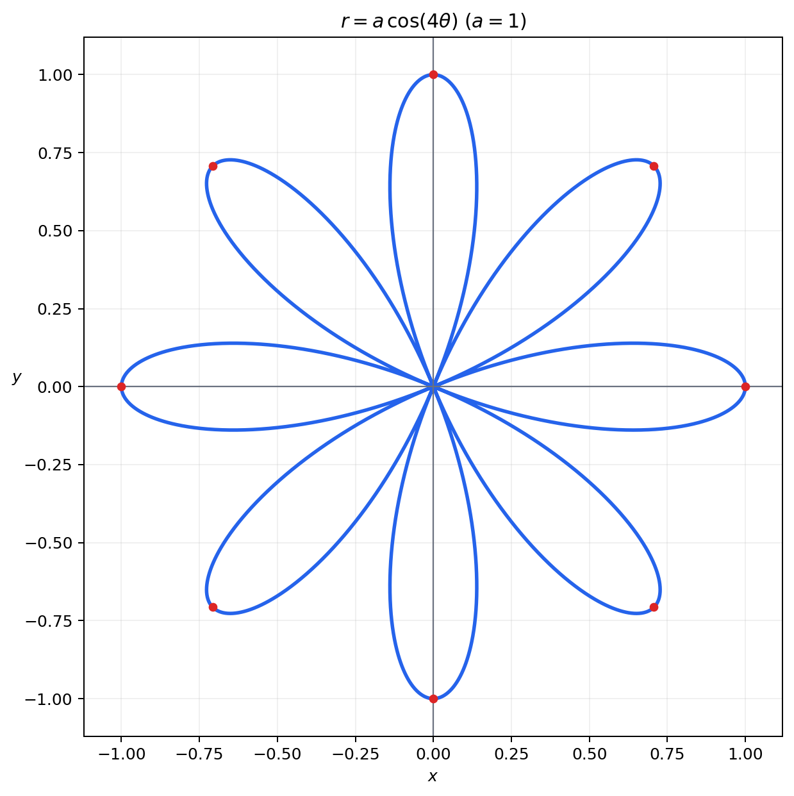

# Homework 2 参考答案

教材：《大学数学微积分 上册 第2版》  
范围：

- 第 1 章：22(4)(6)、23、24(2)、25(3)
- 第 2 章：1、2(4)(5)(6)、3、6、8(3)、9(1)、11、12(3)

> 本文供助教核对。等价参数化、等价的 $N(\varepsilon)$ 选取和正确的其他证明方法均可接受。

# 第 1 章

## 第 22 题：将隐函数方程化为参数方程

### (4)

原方程为

$$
\frac{(x+1)^2}{4}-\frac{(y-2)^2}{9}=1.
$$

利用恒等式 $\sec^2t-\tan^2t=1$，令

$$
\frac{x+1}{2}=\sec t,\qquad \frac{y-2}{3}=\tan t.
$$

得到参数方程

$$
\boxed{
\begin{cases}
x=-1+2\sec t,\\
y=2+3\tan t,
\end{cases}
\quad
t\in[0,2\pi),\quad
t\ne\frac{\pi}{2},\frac{3\pi}{2}.
}
$$

该参数范围覆盖双曲线的两个分支。

### (6)

原方程为

$$
e^y+y^3+2x=1.
$$

取 $y=t$，解出 $x$：

$$
2x=1-e^t-t^3.
$$

所以参数方程为

$$
\boxed{
\begin{cases}
x=\dfrac{1-e^t-t^3}{2},\\
y=t,
\end{cases}
\quad t\in\mathbb R.
}
$$

## 第 23 题：小圆在大圆内滚动

大圆半径为 $R=a$，小圆半径为

$$
r=\frac a4.
$$

设小圆圆心绕大圆圆心转过的角为 $t$。小圆圆心的轨迹为半径 $R-r=3a/4$ 的圆。内滚时无滑动，因此小圆相对圆心转过的角为

$$
\frac{R-r}{r}t=3t,
$$

方向与圆心公转方向相反。

定点 $P$ 的参数方程为

$$
\begin{cases}
x=(R-r)\cos t+r\cos\left(\dfrac{R-r}{r}t\right),\\[2mm]
y=(R-r)\sin t-r\sin\left(\dfrac{R-r}{r}t\right).
\end{cases}
$$

代入 $R=a$、$r=a/4$：

$$
\begin{cases}
x=\dfrac{3a}{4}\cos t+\dfrac a4\cos3t,\\[2mm]
y=\dfrac{3a}{4}\sin t-\dfrac a4\sin3t.
\end{cases}
$$

利用三倍角公式化简：

$$
\boxed{
\begin{cases}
x=a\cos^3t,\\
y=a\sin^3t,
\end{cases}
\quad 0\le t\le2\pi.
}
$$

消去参数可得轨迹方程

$$
\boxed{x^{2/3}+y^{2/3}=a^{2/3}},
$$

即一条四尖瓣内摆线（星形线）。

## 第 24 题 (2)：化为极坐标方程

原方程为

$$
x^2-4x+y^2=0.
$$

代入

$$
x=r\cos\theta,\qquad y=r\sin\theta,\qquad x^2+y^2=r^2,
$$

得到

$$
r^2-4r\cos\theta=0.
$$

因此该圆的极坐标方程可写为

$$
\boxed{r=4\cos\theta},
$$

取 $r\ge0$ 并使曲线恰好描绘一次时，

$$
\boxed{-\frac{\pi}{2}\le\theta\le\frac{\pi}{2}}.
$$

端点均对应原点。

## 第 25 题 (3)：画出 $r=a\cos4\theta$

曲线关于 $x$ 轴、$y$ 轴以及直线 $y=\pm x$ 对称。

当

$$
\theta=\frac{k\pi}{4},\qquad k=0,1,\ldots,7
$$

时，$|r|=a$；相应端点分布在辐角为 $k\pi/4$ 的 8 条射线上。因此曲线共有 8 个花瓣，每个花瓣的最大长度为 $a$。

# 第 2 章

## 第 1 题：观察并证明数列极限

### (1)

$$
a_n=\frac{(-1)^n}{2^n}.
$$

由

$$
|a_n-0|=\frac1{2^n}
$$

可观察出

$$
\boxed{\lim_{n\to\infty}a_n=0}.
$$

证明：任给 $\varepsilon>0$，取正整数 $N$ 使

$$
N>\log_2\frac1\varepsilon.
$$

当 $n>N$ 时，

$$
|a_n|=\frac1{2^n}<\frac1{2^N}<\varepsilon.
$$

故极限为 $0$。

### (2)

数列为

$$
a_1=0.9,\quad a_2=0.99,\quad\ldots,\quad
a_n=\underbrace{0.99\cdots9}_{n\text{ 个 }9}=1-10^{-n}.
$$

因此

$$
\boxed{\lim_{n\to\infty}a_n=1}.
$$

证明：任给 $\varepsilon>0$，取正整数 $N$ 使

$$
N>\log_{10}\frac1\varepsilon.
$$

当 $n>N$ 时，

$$
|a_n-1|=10^{-n}<10^{-N}<\varepsilon.
$$

## 第 2 题：用 $\varepsilon$-$N$ 定义证明

### (4)

已知

$$
\lim_{n\to\infty}a_n=a.
$$

证明

$$
\boxed{\lim_{n\to\infty}\sqrt[3]{a_n}=\sqrt[3]a}.
$$

令

$$
u=\sqrt[3]{a_n},\qquad v=\sqrt[3]a.
$$

注意到

$$
|a_n-a|=|u-v|\,(u^2+uv+v^2)
$$

且

$$
u^2+uv+v^2\ge\frac{(u-v)^2}{4}.
$$

所以

$$
|a_n-a|\ge\frac{|u-v|^3}{4},
$$

从而

$$
\left|\sqrt[3]{a_n}-\sqrt[3]a\right|
\le\sqrt[3]{4|a_n-a|}.
$$

任给 $\varepsilon>0$。由 $a_n\to a$，存在 $N$，使 $n>N$ 时

$$
|a_n-a|<\frac{\varepsilon^3}{4}.
$$

于是

$$
\left|\sqrt[3]{a_n}-\sqrt[3]a\right|<\varepsilon.
$$

结论成立。

### (5)

证明

$$
\boxed{\lim_{n\to\infty}\frac{n!}{n^n}=0}.
$$

当 $n\ge2$ 时，

$$
\frac{n!}{n^n}
=\frac1n\cdot\frac2n\cdots\frac nn.
$$

令 $m=\lfloor n/2\rfloor$。前 $m$ 个因子均不超过 $1/2$，其余因子均不超过 $1$，故

$$
0<\frac{n!}{n^n}\le\left(\frac12\right)^m.
$$

任给 $\varepsilon>0$，先取正整数 $M$ 使 $2^{-M}<\varepsilon$，再取 $N=2M$。当 $n>N$ 时，$\lfloor n/2\rfloor\ge M$，因此

$$
0<\frac{n!}{n^n}\le2^{-\lfloor n/2\rfloor}\le2^{-M}<\varepsilon.
$$

故极限为 $0$。

### (6)

证明

$$
\boxed{\lim_{n\to\infty}
\left(\sin\sqrt{n+1}-\sin\sqrt n\right)=0}.
$$

利用

$$
|\sin u-\sin v|\le|u-v|,
$$

可得

$$
\begin{aligned}
\left|\sin\sqrt{n+1}-\sin\sqrt n\right|
&\le\sqrt{n+1}-\sqrt n\\
&=\frac1{\sqrt{n+1}+\sqrt n}\\
&\le\frac1{2\sqrt n}.
\end{aligned}
$$

任给 $\varepsilon>0$，取

$$
N>\frac1{4\varepsilon^2}.
$$

当 $n>N$ 时，上式小于 $\varepsilon$，故极限为 $0$。

## 第 3 题

设 $\{a_n\}$ 为正项数列，并且

$$
\lim_{n\to\infty}\frac{a_{n+1}}{a_n}=0.
$$

取 $\varepsilon=1$。由极限定义，存在正整数 $N$，使得当 $n>N$ 时，

$$
\left|\frac{a_{n+1}}{a_n}\right|<1.
$$

由于 $a_n>0$，所以

$$
0<\frac{a_{n+1}}{a_n}<1,
$$

即

$$
a_{n+1}<a_n.
$$

因此

$$
\boxed{\{a_n\}\text{ 从某一项起严格单调减少}}.
$$

## 第 6 题

已知

$$
\lim_{n\to\infty}a_n=a,\qquad a\ne0.
$$

因为删去或平移有限项不改变极限，所以

$$
\lim_{n\to\infty}a_{n+1}=a.
$$

又由于 $a\ne0$，由商的极限定理，

$$
\boxed{
\lim_{n\to\infty}\frac{a_{n+1}}{a_n}
=\frac aa=1.
}
$$

当 $a=0$ 时，该比值的极限不一定存在。例如令

$$
a_n=
\begin{cases}
\dfrac1n,&n\text{ 为奇数},\\[1mm]
\dfrac1{n^2},&n\text{ 为偶数}.
\end{cases}
$$

显然 $a_n\to0$，但

$$
\frac{a_{n+1}}{a_n}\to0
\quad(n\text{ 为奇数}),
$$

而

$$
\frac{a_{n+1}}{a_n}\to+\infty
\quad(n\text{ 为偶数}).
$$

因此

$$
\boxed{a=0\text{ 时不能保证 }\lim_{n\to\infty}\frac{a_{n+1}}{a_n}\text{ 存在}}.
$$

## 第 8 题 (3)：根据定义判断极限

$$
a_n=\frac{n+(-1)^n}{n^2-1}.
$$

该表达式从 $n\ge2$ 起有定义；数列有限个首项不影响极限。

当 $n>1$ 时，

$$
|n+(-1)^n|\le n+1,
$$

所以

$$
|a_n|
\le\frac{n+1}{n^2-1}
=\frac1{n-1}.
$$

任给 $\varepsilon>0$，取正整数

$$
N>1+\frac1\varepsilon.
$$

当 $n>N$ 时，

$$
|a_n|<\frac1{N-1}<\varepsilon.
$$

因此

$$
\boxed{\lim_{n\to\infty}\frac{n+(-1)^n}{n^2-1}=0}.
$$

## 第 9 题 (1)：用定义证明数列发散

$$
x_n=\ln n.
$$

任给 $M>0$，取正整数

$$
N>e^M.
$$

当 $n>N$ 时，

$$
x_n=\ln n>\ln N>M.
$$

所以

$$
\boxed{x_n=\ln n\to+\infty},
$$

从而该数列不存在有限极限，是发散数列。

## 第 11 题：证明定理 2.4

设 $x_n\ne0$。这里的 $x_n\to\infty$ 表示 $|x_n|\to+\infty$。

### (1)

证明

$$
\boxed{|x_n|\to+\infty
\iff
\frac1{x_n}\to0}.
$$

若 $|x_n|\to+\infty$，任给 $\varepsilon>0$，取 $M=1/\varepsilon$。当 $n$ 充分大时，

$$
|x_n|>M=\frac1\varepsilon,
$$

故

$$
\left|\frac1{x_n}\right|<\varepsilon.
$$

反之，若 $1/x_n\to0$，任给 $M>0$，取 $\varepsilon=1/M$。当 $n$ 充分大时，

$$
\left|\frac1{x_n}\right|<\frac1M,
$$

所以

$$
|x_n|>M.
$$

因此两者等价。

### (2)

证明

$$
\boxed{x_n\to0
\iff
\left|\frac1{x_n}\right|\to+\infty}.
$$

若 $x_n\to0$，任给 $M>0$，取 $\varepsilon=1/M$。当 $n$ 充分大时，

$$
|x_n|<\frac1M,
$$

从而

$$
\left|\frac1{x_n}\right|>M.
$$

反之，若 $|1/x_n|\to+\infty$，任给 $\varepsilon>0$，取 $M=1/\varepsilon$。当 $n$ 充分大时，

$$
\left|\frac1{x_n}\right|>\frac1\varepsilon,
$$

所以

$$
|x_n|<\varepsilon.
$$

故 $x_n\to0$。

## 第 12 题 (3)：计算数列极限

求

$$
\lim_{n\to\infty}\frac{1^2+2^2+\cdots+n^2}{n^3}.
$$

利用平方和公式

$$
1^2+2^2+\cdots+n^2
=\frac{n(n+1)(2n+1)}6,
$$

得到

$$
\begin{aligned}
\lim_{n\to\infty}
\frac{1^2+2^2+\cdots+n^2}{n^3}
&=
\lim_{n\to\infty}
\frac{n(n+1)(2n+1)}{6n^3}\\
&=
\lim_{n\to\infty}
\frac{(1+1/n)(2+1/n)}6\\
&=\boxed{\frac13}.
\end{aligned}
$$

